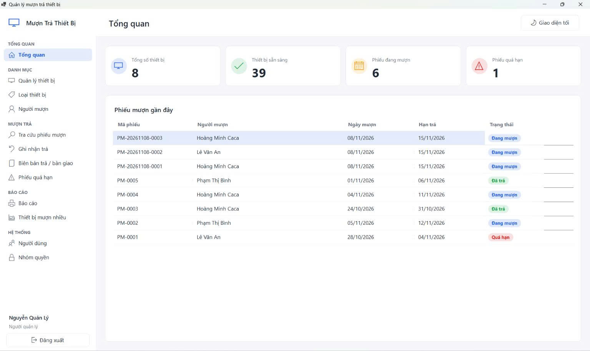

# BÁO CÁO ĐỒ ÁN – QUẢN LÝ MƯỢN TRẢ THIẾT BỊ

## Trang bìa

- Trường: **ĐẠI HỌC SƯ PHẠM THÀNH PHỐ HỒ CHÍ MINH**
- Khoa: **CÔNG NGHỆ THÔNG TIN**
- Học phần: 2611COMP101904
- Đề tài: **Quản lý mượn trả thiết bị**
- Giảng viên hướng dẫn: Th.S Lê Thanh Thoại – Khoa CNTT
- Nhóm: 4
- Thành viên:
  - Ngô Minh Hải – MSSV: 51.01.104.022
  - Đỗ Việt Hoàng – MSSV: 51.01.104.031
  - Lê Hoàng Quân – MSSV: 51.01.104.082
- Năm học: 2026–2027

## 1. Giới thiệu đề tài

Đề tài xây dựng ứng dụng desktop hỗ trợ quản lý danh mục thiết bị và người mượn, lập phiếu mượn nhiều thiết bị, ghi nhận trả và theo dõi biên bản bàn giao. Hệ thống nhằm giảm thao tác thủ công, kiểm soát số lượng thiết bị khả dụng và hỗ trợ tra cứu lịch sử mượn trả.

**Thành viên thực hiện:**

| Họ tên | MSSV |
|---|---|
| Đỗ Việt Hoàng | 51.01.104.031 |
| Lê Hoàng Quân | 51.01.104.082 |
| Ngô Minh Hải | 51.01.104.022 |

## 2. Phân tích yêu cầu

### 2.1. Vai trò người dùng

- **Người quản lý:** quản trị tài khoản, nhóm quyền, cấu hình hệ thống và xem báo cáo.
- **Nhân viên kho:** quản lý dữ liệu nghiệp vụ theo phân quyền, lập phiếu mượn, ghi nhận trả và tra cứu phiếu quá hạn.

### 2.2. Chức năng

- Quản lý thiết bị, loại thiết bị và người mượn.
- Lập và tra cứu phiếu mượn.
- Ghi nhận trả đủ hoặc trả một phần, phân loại tình trạng thiết bị khi trả.
- Quản lý biên bản trả, tra cứu phiếu quá hạn.
- Báo cáo, thống kê, in biểu mẫu và cấu hình quy tắc sinh mã tự động.

## 3. Phân tích và thiết kế

### 3.1. Công nghệ sử dụng

- Ngôn ngữ lập trình: C#.
- Giao diện: Windows Forms.
- Cơ sở dữ liệu: Microsoft SQL Server.
- Thư viện truy cập dữ liệu: Dapper.
- Kiến trúc: nhiều tầng gồm UI – Services (BLL) – Data (DAL) – Models.

### 3.2. Các bảng dữ liệu

`Users`, `Roles`, `Permissions`, `RolePermissions`, `DeviceCategories`, `Devices`, `Borrowers`, `LoanSlips`, `LoanSlipDetails`, `ReturnRecords`, `ReturnRecordDetails`, `CodeConfigs`.

### 3.3. Quy tắc nghiệp vụ

- Khi lập phiếu mượn, hệ thống kiểm tra tồn kho và trừ số lượng khả dụng trong cùng một transaction.
- Khi ghi nhận trả, hệ thống kiểm tra số lượng còn phải trả và cập nhật số lượng theo từng nhóm tình trạng thiết bị.
- Khi hủy biên bản trả, hệ thống chỉ hoàn tác nếu số lượng tồn kho hiện tại cho phép.
- Phiếu quá hạn được xác định dựa trên hạn trả và số lượng thiết bị chưa trả.

## 4. Giao diện và chức năng

Ảnh chụp màn hình thực tế của hệ thống (giao diện Dashboard quản trị):

Liên kết ảnh: https://github.com/viethoang234-se/2611COMP101904-LTW-KhaBi/blob/main/report/images/hinh4_09_dashboard_admin.png

## 5. Kiểm thử

- Sử dụng bảng ca kiểm thử trong `TEST_CASES.md`.
- Nêu rõ môi trường kiểm thử, dữ liệu kiểm thử, kết quả mong đợi và kết quả thực tế.
- Đính kèm ảnh các trường hợp thành công và các trường hợp hệ thống từ chối dữ liệu không hợp lệ.

## 6. Kết luận và hướng phát triển

**Mức độ hoàn thành:** Nhóm đã xây dựng hoàn chỉnh các chức năng chính của hệ thống, gồm quản lý thiết bị và người mượn, lập phiếu mượn nhiều thiết bị, ghi nhận trả đủ hoặc trả một phần, quản lý biên bản trả, tra cứu phiếu quá hạn, báo cáo thống kê, phân quyền và cấu hình mã tự động. Các quy tắc nghiệp vụ về tồn kho được kiểm soát bằng transaction, bảo đảm tính nhất quán dữ liệu.

**Hạn chế:** Ứng dụng hiện chỉ chạy trên nền tảng Windows và kết nối trực tiếp đến SQL Server, chưa hỗ trợ truy cập từ xa hay trên thiết bị di động. Hệ thống chưa có tính năng nhắc hạn trả tự động.

**Hướng phát triển:**

- Phát triển phiên bản web hoặc ứng dụng di động.
- Bổ sung thông báo nhắc hạn trả qua email hoặc tin nhắn.
- Hỗ trợ quét mã vạch/QR để lập phiếu và trả thiết bị nhanh hơn.
- Mở rộng báo cáo thống kê trực quan và xuất dữ liệu nhiều định dạng.

## 7. Phân công và mức độ hoàn thành

| STT | Họ tên | MSSV | Công việc thực tế | Mức độ hoàn thành |
|---|---|---|---|---|
| 1 | Đỗ Việt Hoàng | 51.01.104.031 | Thiết kế giao diện, trải nghiệm người dùng (UI/UX) | 100% |
| 2 | Lê Hoàng Quân | 51.01.104.082 | Thiết kế logic nghiệp vụ, kiến trúc phần mềm | 100% |
| 3 | Ngô Minh Hải | 51.01.104.022 | Kiểm thử phần mềm, viết báo cáo | 100% |

## Phụ lục

- Hướng dẫn cài đặt và kết nối SQL Server.
- Tài khoản mẫu và lưu ý đổi mật khẩu.
- Danh sách script SQL.
- Link repository: https://github.com/viethoang234-se/2611COMP101904-LTW-KhaBi
